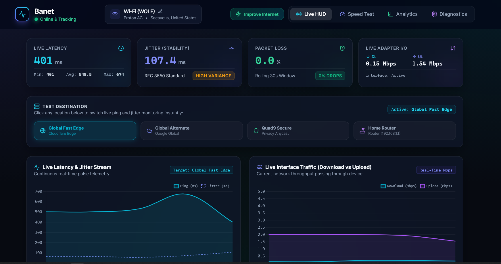

# ⚡ Banet — Live Internet Telemetry & Speed Dashboard



**Banet** is a smooth, real-time internet performance monitor, speed benchmark, and network optimization suite designed to run entirely locally. 

Built with a modern glassmorphism UI, it continuously tracks live internet statistics, evaluates connection quality, auto-identifies your active network, **remembers connection names** for persistent historical analytics, and provides direct tools to **boost your connection and restart your router**.

---

## 🔥 Core Features

### 1. Live HUD & Real-Time Telemetry
- **Ping & Latency (ms):** 1-second continuous pulse monitoring with min/avg/max tracking.
- **Interarrival Jitter (ms):** Real-time latency variance tracking (RFC 3550 Standard) for stability assessment.
- **Rolling Packet Loss (%):** Calculates packet drop percentage over a rolling 30-second window.
- **Adapter I/O Bandwidth:** Measures exact live download and upload bytes passing through your active network interface.
- **Target Switching:** Click any destination pill to switch live tracking instantly (**Global Fast Edge**, **Global Alternate**, **Quad9 Secure**, or **Home Router**).
- **Live Waveform Charts:** Smooth, real-time streaming line graphs powered by WebSockets and Chart.js.

### 2. Network Optimizer & Router Controls
- **Quick Optimization:** Flushes Windows DNS resolver cache, purges stale routing paths, and verifies latency reduction.
- **Router Reboot:** Sends UPnP reboot/reconnect commands directly to your router gateway (`192.168.1.1`) to clear congested NAT states.
- **Direct Console Access:** One-click link to open your router's admin portal in your browser.

### 3. Comprehensive Speed Benchmarks
- **Animated Speedometer:** Custom SVG speedometer with gradient neon animations.
- **Multi-Phase Testing:** Ping test, server selection, download test, upload test, and bufferbloat estimation.
- **Experience Grading:** Automatically calculates letter grades (A+ to D) for:
  - 🎮 **Gaming Score** (Low latency/jitter for esports)
  - 📺 **Streaming Score** (4K Ultra HD readiness)
  - 📹 **Video Conferencing** (Stability for Zoom/Teams)
  - 📶 **Bufferbloat Grade** (Latency increase under load)

### 4. Auto-Network Fingerprinting
- **Smart Detection:** Automatically detects whether you are on Wi-Fi (SSID, Signal), Ethernet, or a VPN tunnel, gathering public IP, ISP provider, ASN, and Geolocation.
- **Persistent Memory:** Label your network (e.g., *"Home 1G Fiber"*, *"ProtonVPN NYC"*). Banet stores this fingerprint in SQLite and automatically recognizes the network whenever you reconnect!
- **Data Export:** Filter benchmarks by current connection, track averages over time, and export history to CSV or JSON.

---

## 🚀 How to Run Locally

**Option A: One-Click Launcher (Windows)**
Double-click `start.bat` in the project root to automatically launch the server and open your browser to `http://localhost:8000`:
```batch
start.bat
```

**Option B: Terminal Command**
Run directly with Python:
```bash
python run.py
```

---

## 📁 Project Architecture

```text
Internet Tester/
├── app/
│   ├── database.py             # SQLite storage for network profiles & ping logs
│   ├── network_detector.py     # Hardware adapter, SSID, gateway & ISP detection
│   ├── network_optimizer.py    # DNS flush, routing refresh & UPnP router restart
│   ├── live_monitor.py         # 1-sec continuous ping, jitter, packet loss & I/O loop
│   ├── speed_test_service.py   # Benchmark engine with multi-phase reporting & grading
│   ├── routes.py               # REST API endpoints & real-time WebSocket stream
│   └── main.py                 # FastAPI application setup & lifecycle
├── static/
│   ├── css/style.css           # Obsidian glassmorphism design system
│   ├── js/app.js               # Optimizer modal, WebSockets & Chart.js logic
│   ├── vendor/                 # Offline-ready Chart.js & Lucide icon scripts
│   └── index.html              # Single-page dashboard application
├── data/
│   └── internet_tester.db      # Embedded local SQLite database
├── run.py                      # Server starter with auto-port discovery
├── start.bat                   # 1-click Windows batch launcher
├── requirements.txt            # Python dependencies
└── README.md                   # Documentation
```

---

## 🔒 Privacy & Zero Login
- **No accounts or authentication required**.
- All ping logs, connection fingerprints, and speed test records are stored locally inside `data/internet_tester.db` on your machine.
